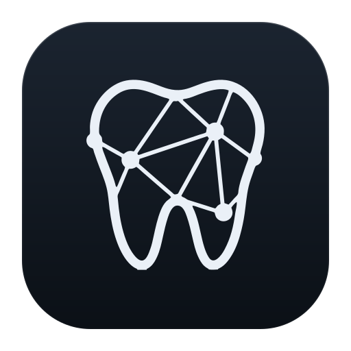

  

<h1 align="center">dentection</h1>

Dental image analysis that runs in the practice.

 

dentection reads radiographs and intraoral photographs, numbers the teeth and proposes findings for each one. It installs on Windows, macOS and Linux and works on the practice's own computer.

### Principles

**The model proposes, the dentist decides.**
Every proposal is released, changed or rejected by a dentist.

**Images stay in the practice.**
Analysis runs on the practice's own computer.

**Encrypted at rest.**
Images and findings are stored encrypted.

**Safety is never behind a paywall.**
Every safeguard is part of every edition.

### Download

[download.dentection.com](https://download.dentection.com)
